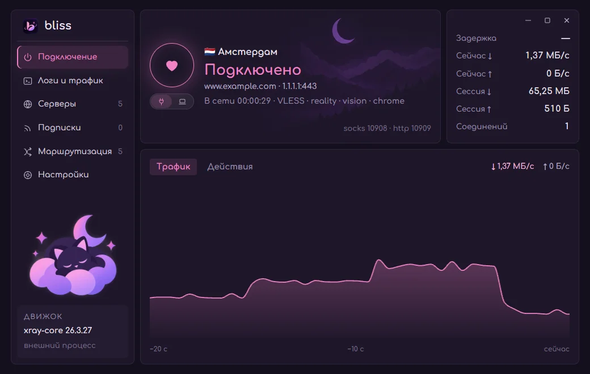
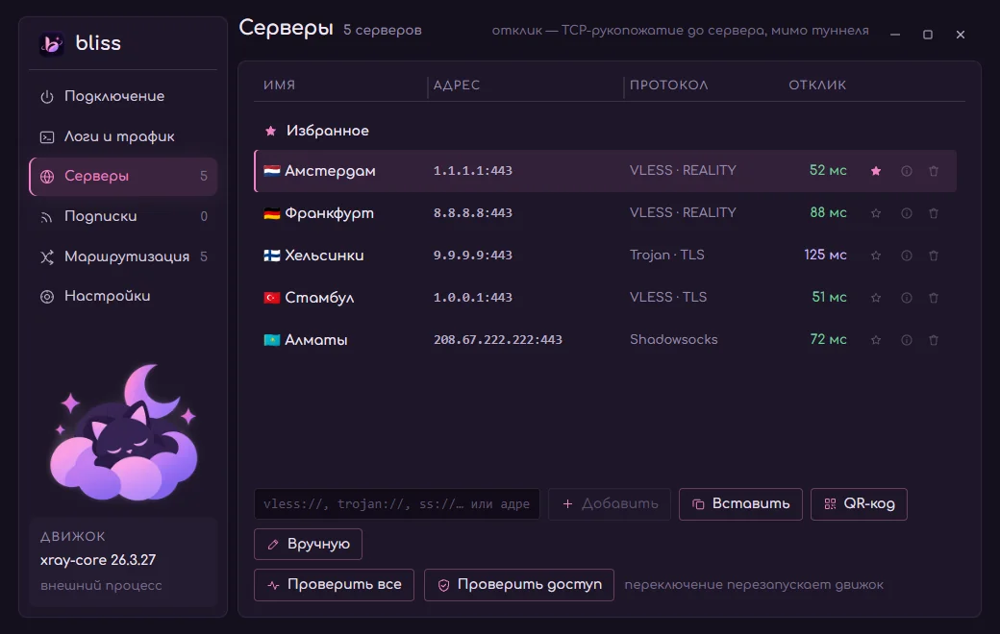
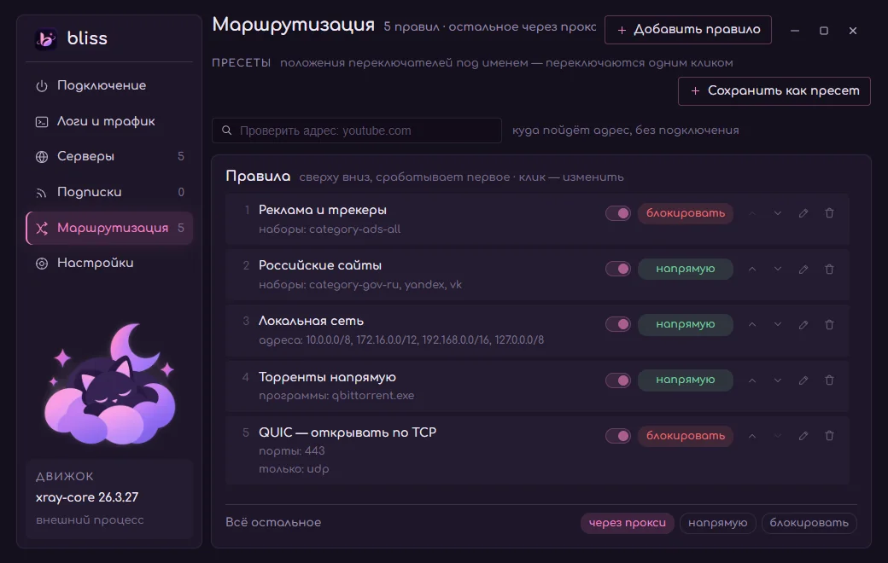
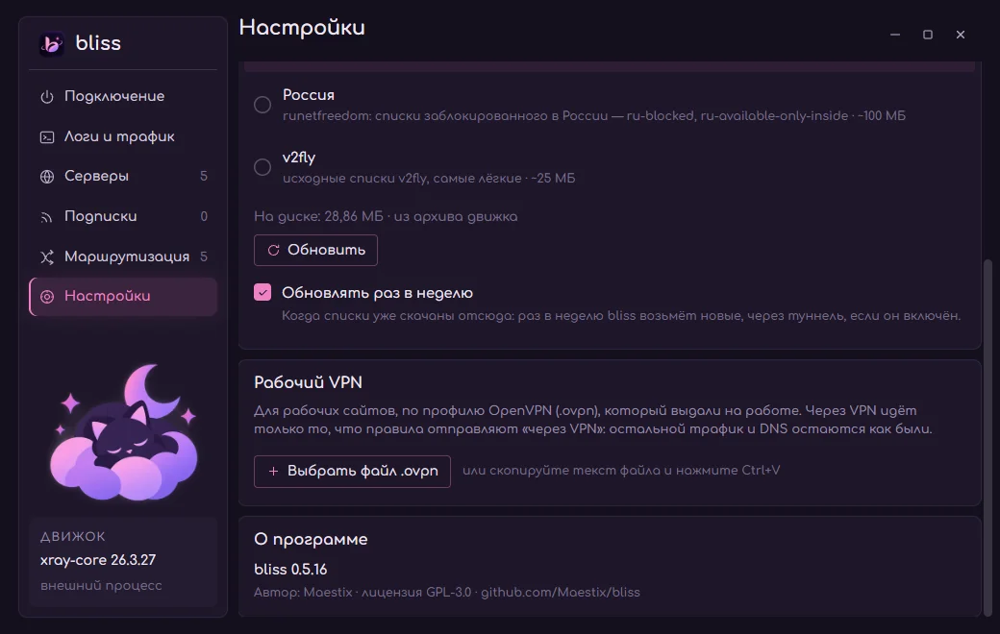

# bliss

Прокси-клиент для Windows, Linux и Android. Вставляете ссылку от своего сервера, нажимаете на сердечко, и трафик идёт через туннель, а правила решают, что пустить мимо.

<p align="center">
  
  
</p>

*English: a proxy client for Windows, Linux and Android, written in Rust on top of xray-core. The interface is Russian only for now. Build steps and the license are below.*

## Что внутри

Под капотом работает [xray-core](https://github.com/XTLS/Xray-core). bliss занимается всем вокруг него: своими SOCKS5- и HTTP-портами, маршрутизацией, системным прокси, подсчётом трафика по соединениям и окном, в котором всё это видно.

Понимает ссылки всех видов, до которых дотягивается xray: VLESS (в том числе REALITY), VMess, Trojan, Shadowsocks, SOCKS, Hysteria 2 и WireGuard. Ссылку можно вставить через Ctrl+V прямо в окне, прочитать с картинки с QR-кодом (подойдёт скриншот или фото) или ввести поля руками.

## Что умеет

**Серверы и подписки**
- Список серверов с откликом: замеряется TCP-рукопожатие до сервера, мимо туннеля, так что видно, кто жив, ещё до переключения.
- Подписки провайдеров обновляются сами раз в 12 часов.
- Любым сервером можно поделиться ссылкой или QR-кодом.

**Маршрутизация**
- Правила сверху вниз, срабатывает первое подходящее: по доменам, `geosite`, `geoip`, адресам, портам и программам. Каждое правило можно выключить ползунком, не удаляя.
- Пресеты: положения всех ползунков сохраняются под именем и переключаются одним кликом, хоть из меню в трее.
- Перед сохранением можно проверить, куда пойдёт адрес, и подключаться для этого не нужно. Если в правиле есть категория, которой нет в гео-файлах, bliss об этом скажет.

**Система**
- Системный прокси Windows: bliss включает его, только когда туннель действительно поднялся, и возвращает прежние настройки на выходе. Даже если bliss убили, при следующем запуске он вернёт всё как было.
- Режим TUN заворачивает в туннель всю машину, включая UDP, то есть звонки, игры и QUIC. Нужны права администратора.
- Рабочий VPN рядом с туннелем: bliss берёт `.ovpn` из офиса и запускает официальный OpenVPN, но пускает через него только то, что вы отправили правилами. Остальной трафик и DNS остаются как были.
- Гео-файлы можно взять из трёх источников (Loyalsoldier, runetfreedom, v2fly), они обновляются раз в неделю.
- Запуск вместе с системой, по желанию сразу свёрнутым в трей.

<p align="center">
  
  
</p>

*Серверы на скриншотах выдуманные: их адреса принадлежат публичным DNS, чтобы было что пинговать.*

## Установка

Всё лежит в [Releases](../../releases):

| Система | Файл |
|---|---|
| Windows 10/11, x64 | `bliss-…-windows-x86_64.exe`, один файл без установки |
| Linux x64 (Ubuntu 22.04, Debian 12, Mint 21 и новее) | `bliss-…-linux-amd64.deb` или `…-linux-x86_64.tar.gz` |
| Android 10+, arm64 | `bliss-…-android-arm64.apk` |

На Windows и Linux при первом запуске bliss предложит скачать движок xray-core, это одна кнопка. В APK движок уже встроен.

> **Android, версии после 0.5.16.** С ними APK подписан новым ключом, поэтому поверх 0.5.16 и более старых он не встанет: Android откажется. Удалите bliss и поставьте заново. Серверы перед этим можно сохранить: у каждого есть «Поделиться» со ссылкой.

## Сборка

Нужен Rust 1.88 или новее.

```sh
cargo build --release          # Windows: target/release/bliss.exe
./build-linux.sh               # Linux: проверит зависимости, предложит доставить недостающие и соберёт
```

Для Android нужны NDK r28+, таргет `aarch64-linux-android` и Go (из исходников собирается xray):

```sh
android/build-native.sh        # libbliss.so и libxray.so
cd android && gradle assembleRelease
```

Без файла `android/keystore.properties` APK подпишется отладочным ключом. Такой APK запустится, но поверх версии из Releases не встанет.

Устройство проекта, решения и найденные по дороге грабли подробно описаны в [AGENTS.md](AGENTS.md). Это заметки для ИИ-агентов, но людям они тоже пригодятся.

## Лицензия

[GPL-3.0-or-later](LICENSE) с одним дополнительным условием по пункту 7(b): в распространяемых версиях должна остаться строка об авторе в «О программе». Подробности и лицензии сторонних частей (xray-core под MPL-2.0, шрифты под OFL) в [NOTICE](NOTICE).
